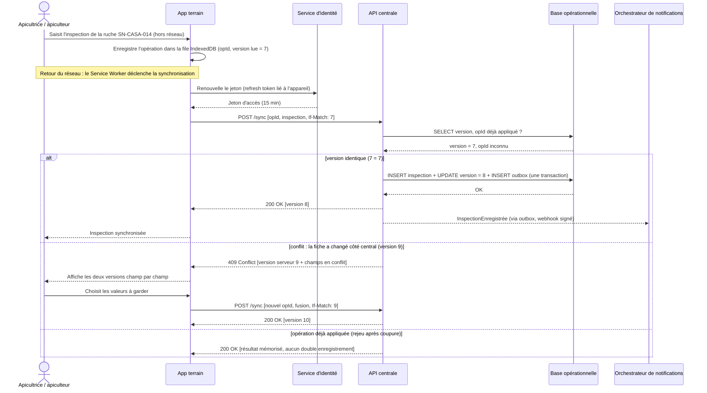

# Séquence · Synchroniser une inspection saisie hors ligne (UC-A01) · parcours Dev

Participants : personnes et conteneurs du N2 (mêmes noms). Traits pleins = appels synchrones, pointillés = réponses ou événements.

